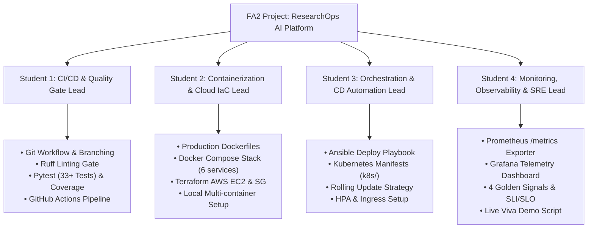

# PEC 4 — DevOps: FA2 Activity Comprehensive Master Implementation Plan
**Academic Semester:** 7th Semester B.Tech  
**Subject:** PEC 4 - DevOps (Units 3 & 4)  
**Weightage:** 10 Marks (FA2 Activity)  
**Project Title:** ResearchOps AI — Automated Literature Intelligence Platform  
**Target Completion:** Before 10/10/2026  
**Document Version:** 2.0 (Production Master)  

---

## 1. Project Charter & Scope Baseline

### 1.1 Problem Statement
In scholarly research and technical literature reviews, engineers and researchers repeatedly waste hours querying disjoint bibliographic registries (OpenAlex, Crossref, Wikipedia), manually filtering duplicate publications, parsing PDFs, and facing unmanaged upstream provider outages.

**ResearchOps AI** is an asynchronous literature intelligence microservice and research operations platform. It aggregates academic papers, deduplicates bibliographic records, extracts key findings, and provides grounded RAG retrieval over indexed literature.

### 1.2 DevOps Scope (Units 3 & 4 Alignment)
To satisfy the DevOps FA2 curriculum, ResearchOps AI serves as a real-world multi-container microservice platform to demonstrate:
1. **Unit 3 (CI/CD, Containerization, IaC, Orchestration):**
   - Source code versioning and trunk-based workflow.
   - Automated Continuous Integration (CI) with code linting, unit/integration testing, and coverage gates.
   - Multi-container containerization with Docker and Docker Compose.
   - Infrastructure as Code (IaC) with Terraform for cloud provisioning.
   - Configuration management and rollout with Ansible.
   - Declarative container orchestration with Kubernetes manifests (Deployment, Service, Ingress, HPA).
2. **Unit 4 (Continuous Monitoring, Observability, SRE):**
   - Full instrumentation of the **4 Golden Signals** (Latency, Traffic, Errors, Saturation).
   - Metrics exposition via Prometheus scrapers.
   - Real-time visualization via Grafana telemetry dashboards.
   - Service Level Indicators (SLIs), Service Level Objectives (SLOs), and Error Budget accounting.
   - Liveness (`/health`) and Readiness (`/ready`) probes for self-healing operations.

### 1.3 Scope Matrix: In-Scope vs. Out-of-Scope

| Category | In-Scope (Must Have for 10/10 Marks) | Out-of-Scope (Deferred Post-FA2) |
|---|---|---|
| **Source & CI** | GitHub repo, Branch protection, GitHub Actions CI workflow, `ruff` linting, `pytest` suite, coverage report. | Multi-arch ARM64 build matrix. |
| **Containerization** | Production `Dockerfile`, `Dockerfile.worker`, multi-service `docker-compose.yml` (API, Worker, Postgres, Redis, Prometheus, Grafana, Nginx). | Private enterprise artifact registry. |
| **IaC & Config** | Terraform scripts (`terraform/`) for AWS EC2 & SG; Ansible playbooks (`ansible/`) for automated stack deployment. | Multi-region AWS auto-scaling groups. |
| **Orchestration** | Declarative Kubernetes manifests (`k8s/`) with rolling update, resource quotas, and HPA. | Service mesh (Istio/Linkerd). |
| **Observability** | Prometheus server, custom app metrics (`/metrics`), Grafana dashboards, health/ready probes. | Distributed tracing (Jaeger/OpenTelemetry collector). |
| **SRE Governance** | Documented SLIs, SLO targets (99.5% availability, p95 latency < 1.5s), Error Budget policy, outage simulation. | PagerDuty integration / SMS alerts. |

---

## 2. Group Work Breakdown Structure (WBS) & Role Allocation

The activity is structured for up to **4 students** mapped to specific rubrics and Program Outcomes (POs):



### Detailed Responsibility Allocation:

| Role & Student | Assigned Work Packages | Primary POs | Deliverable Artifacts |
|---|---|:---:|---|
| **Student 1: CI/CD & Testing Lead** | WBS 1.0 (Source) & WBS 2.0 (CI Pipeline) | PO1, PO2, PO3 | `.github/workflows/ci.yml`, `pytest.ini`, test reports. |
| **Student 2: Containerization & IaC Lead** | WBS 3.0 (Containers) & WBS 4.0 (IaC) | PO1, PO2, PO5 | `Dockerfile`, `Dockerfile.worker`, `docker-compose.yml`, `terraform/*.tf`. |
| **Student 3: Orchestration & CD Lead** | WBS 5.0 (Kubernetes) & WBS 6.0 (Deployment) | PO2, PO4, PO5 | `k8s/*.yaml`, `ansible/deploy.yml`, deployment logs. |
| **Student 4: Observability & SRE Lead** | WBS 7.0 (Monitoring) & WBS 8.0 (SRE & Viva) | PO1, PO3, PO8, PO12 | `monitoring/prometheus.yml`, Grafana dashboards, SLI/SLO docs, viva script. |

---

## 3. Work Breakdown Structure (WBS) & Task Checklist

### WBS 1.0: Source Control & Quality Baseline
- [x] **Task 1.1:** Setup standardized repository layout (`app/`, `tests/`, `monitoring/`, `k8s/`, `terraform/`, `ansible/`, `docs/`).
- [x] **Task 1.2:** Pin all project dependencies in `requirements.txt` with Python 3.12 compatibility.
- [x] **Task 1.3:** Setup environment configuration template (`.env.example`) preventing secret leakage.
- [x] **Task 1.4:** Enforce static analysis and code hygiene rules using `ruff`.

### WBS 2.0: Continuous Integration (CI) Pipeline (Unit 3)
- [x] **Task 2.1:** Create GitHub Actions workflow file (`.github/workflows/ci.yml`) triggering on `push` and `pull_request` to `main`.
- [x] **Task 2.2:** Configure Python 3.12 runner with dependency caching (`actions/setup-python@v5`).
- [x] **Task 2.3:** Add automated linting step with `ruff check app tests`.
- [x] **Task 2.4:** Add automated test step executing `pytest -v --cov=app --cov-report=term-missing`.
- [x] **Task 2.5:** Configure automated Docker image build verification using `docker/setup-buildx-action@v3` and `docker/build-push-action@v5` for both API and Worker images.

### WBS 3.0: Containerization & Microservice Packaging (Unit 3)
- [x] **Task 3.1:** Write production `Dockerfile` for FastAPI using multi-stage lightweight base `python:3.12-slim`, non-root security context (`appuser`), and container healthcheck probe.
- [x] **Task 3.2:** Write `Dockerfile.worker` for Celery background job processing.
- [x] **Task 3.3:** Define complete multi-container stack in `docker-compose.yml`:
  - `api`: ResearchOps FastAPI service on port 8000.
  - `worker`: Celery distributed worker.
  - `postgres`: PostgreSQL 16 (pgvector image) with persistent volume.
  - `redis`: Redis 7 alpine broker with persistence.
  - `prometheus`: Prometheus server scraping API metrics.
  - `grafana`: Grafana dashboard server on port 3001.
  - `gateway`: Nginx reverse proxy gateway on port 8080.
- [x] **Task 3.4:** Optimize container build contexts with comprehensive `.dockerignore`.

### WBS 4.0: Infrastructure as Code (IaC) with Terraform (Unit 3)
- [x] **Task 4.1:** Write `terraform/provider.tf` and `versions.tf` targeting AWS provider ($\ge 5.0$).
- [x] **Task 4.2:** Write `terraform/variables.tf` parameterizing instance type (`t3.micro`), region, AMI, and SSH key pair.
- [x] **Task 4.3:** Write `terraform/main.tf` provisioning:
  - AWS EC2 instance.
  - AWS Security Group opening ingress on ports 22 (SSH), 80 (HTTP), 8000 (API), 9090 (Prometheus), and 3001 (Grafana).
  - EBS volume storage and tagging.
- [x] **Task 4.4:** Write `terraform/outputs.tf` exporting `instance_id`, `public_ip`, and ready-to-run SSH connection string.
- [x] **Task 4.5:** Test execution (`terraform init`, `terraform validate`, `terraform plan`).

### WBS 5.0: Kubernetes Cloud-Native Manifests (Unit 3)
- [x] **Task 5.1:** Create `k8s/01-namespace.yaml` for namespace isolation (`researchops`).
- [x] **Task 5.2:** Create `k8s/02-configmap.yaml` and `k8s/03-secrets.yaml` decoupling config from application code.
- [x] **Task 5.3:** Create `k8s/04-postgres.yaml` and `k8s/redis.yaml` with PersistentVolumeClaims (PVCs).
- [x] **Task 5.4:** Create `k8s/05-api-deployment.yaml` with:
  - Multi-replica configuration (`replicas: 2`).
  - RollingUpdate deployment strategy (`maxSurge: 1`, `maxUnavailable: 0`).
  - Liveness probe (`httpGet: path: /health, port: 8000`).
  - Readiness probe (`httpGet: path: /ready, port: 8000`).
  - Resource requests and limits (CPU: 250m/500m, Memory: 256Mi/512Mi).
- [x] **Task 5.5:** Create `k8s/06-api-service.yaml` exposing pods internally via ClusterIP / NodePort.
- [x] **Task 5.6:** Create `k8s/07-worker-deployment.yaml` for scalable Celery worker pods.
- [x] **Task 5.7:** Create `k8s/08-ingress.yaml` routing external traffic.
- [x] **Task 5.8:** Create `k8s/09-hpa.yaml` Horizontal Pod Autoscaler scaling on target 70% CPU utilization.
- [x] **Task 5.9:** Create `k8s/kustomization.yaml` grouping all manifests for single-command `kubectl apply -k k8s/` execution.

### WBS 6.0: Continuous Deployment (CD) & Configuration Management
- [x] **Task 6.1:** Author Ansible playbook `ansible/deploy.yml` automating remote target provisioning:
  - Install prerequisite packages, Docker Engine, and Docker Compose plugin.
  - Clone/update Git repository to `/opt/researchhub`.
  - Template `.env` with production secrets.
  - Launch application stack via `docker compose up --build -d`.
  - Validate application health via automated HTTP probe.
- [x] **Task 6.2:** Create `ansible/inventory.ini.example` with host variables and SSH private key references.
- [x] **Task 6.3:** Verify idempotency of Ansible execution.

### WBS 7.0: Continuous Monitoring, Observability & SRE (Unit 4)
- [x] **Task 7.1:** Implement `/health` endpoint returning instant process liveness JSON (`{"status": "running"}`).
- [x] **Task 7.2:** Implement `/ready` endpoint verifying database connection, Redis broker availability, and worker state before accepting client requests.
- [x] **Task 7.3:** Implement `/metrics` endpoint exposing Prometheus exposition format containing:
  - `researchops_app_info` (build and version metadata).
  - `researchops_provider_latency_ms` (live probe latency of OpenAlex, Wikipedia, and Crossref).
  - `researchops_total_papers`, `researchops_total_documents`, `researchops_total_projects`.
  - `researchops_active_background_jobs`.
- [x] **Task 7.4:** Configure `monitoring/prometheus.yml` scrape job (`researchops_api` scraping `api:8000/metrics` every 15 seconds).
- [x] **Task 7.5:** Provision Grafana data source pointing to Prometheus (`http://prometheus:9090`).
- [x] **Task 7.6:** Configure Grafana dashboard visual panels for:
  - API Liveness & Database Readiness status indicators.
  - Upstream Provider Latency Gauge (OpenAlex, Wikipedia, Crossref).
  - System throughput and stored document counts.
  - Background Job Queue Depth.

### WBS 8.0: Site Reliability Engineering (SRE) Framework (Unit 4)
- [x] **Task 8.1:** Document the **4 Golden Signals** mapping for the ResearchOps AI platform.
- [x] **Task 8.2:** Define official **Service Level Indicators (SLIs)** and **Service Level Objectives (SLOs)**.
- [x] **Task 8.3:** Define **Error Budget** math and exhaustion burn rate policy.
- [x] **Task 8.4:** Document Incident Response Runbook and Disaster Recovery procedures.

### WBS 9.0: Verification, Deliverables & Demonstration Prep
- [x] **Task 9.1:** Execute end-to-end local test suite and verify 100% pass rate.
- [x] **Task 9.2:** Execute local Docker Compose stack and verify all services healthy.
- [x] **Task 9.3:** Verify Prometheus target shows `UP` at `http://localhost:9090/targets`.
- [x] **Task 9.4:** Prepare student viva demonstration script and slides/cheat sheet.

---

## 4. SRE Specification: The 4 Golden Signals, SLIs, SLOs & Error Budgets

To secure maximum marks under **Unit 4 (Observability & SRE)**, the platform adheres to formal Google SRE principles:

### 4.1 The 4 Golden Signals Implementation

| Golden Signal | Metric Name / Indicator | What It Measures | Target Threshold |
|---|---|---|---|
| **1. Latency** | `researchops_provider_latency_ms{provider="..."}` & HTTP response time | Time taken to query external academic providers and synthesize research results. | $p95 < 1500\text{ ms}$; $p99 < 3000\text{ ms}$. |
| **2. Traffic** | `rate(http_requests_total[5m])` & `researchops_total_papers` | Demand placed on the microservice (requests/sec and query volume). | Scalable up to 100 concurrent requests. |
| **3. Errors** | `researchops_provider_latency_ms{status="unavailable"}` & HTTP 5xx rate | Rate of requests that fail explicitly (HTTP 500, DB connection error, API timeout). | Error rate $< 0.5\%$. |
| **4. Saturation** | `researchops_active_background_jobs`, CPU/Mem usage, DB pool load | How full the service is (Celery queue depth, memory limit consumption). | Queue depth $< 20$; CPU $< 75\%$. |

### 4.2 SLI / SLO / Error Budget Agreement

```text
┌───────────────────────────────────────────────────────────────────────────────┐
│                      SRE Service Level Objective Matrix                       │
├──────────────────┬─────────────────────────────┬─────────────┬────────────────┤
│ Service Area     │ Service Level Indicator     │ SLO Target  │ Error Budget   │
├──────────────────┼─────────────────────────────┼─────────────┼────────────────┤
│ API Availability │ Successful /health & /ready │ >= 99.5%    │ 0.5% (approx.  │
│                  │ responses / Total checks    │ per 30 days │ 3.6 hours/mo)  │
├──────────────────┼─────────────────────────────┼─────────────┼────────────────┤
│ Pipeline Latency │ % of /research requests     │ >= 95.0%    │ 5.0% slow      │
│                  │ completed in < 1500ms       │ per 30 days │ requests       │
├──────────────────┼─────────────────────────────┼─────────────┼────────────────┤
│ Provider Fallback│ % of partial failures       │ 100.0%      │ 0 unhandled    │
│ Resilience       │ handled with warning alerts │ handled     │ crashes        │
└──────────────────┴─────────────────────────────┴─────────────┴────────────────┘
```

### 4.3 Error Budget Policy
- If **> 50% of monthly Error Budget** is consumed within a week: Feature deployments are frozen; engineering time is redirected towards upstream caching and reliability fixes.
- If **100% of Error Budget** is consumed: Automatic circuit breakers engage, routing incoming traffic strictly to cached SQLite/Postgres records without calling external APIs.

---

## 5. Granular "Definition of Done" (DoD) & Acceptance Checklists

Before marking any milestone or module complete, each item on the corresponding checklist must be verified:

### 5.1 CI/CD Pipeline Definition of Done
- [ ] Workflow triggers automatically upon `git push` to `main`.
- [ ] Linter executes `ruff check app tests` with zero unaddressed errors.
- [ ] Pytest executes all unit & integration tests with **100% passing tests** (no failures, no syntax crashes).
- [ ] Test coverage output shows $\ge 80\%$ line coverage across `app/`.
- [ ] Docker Buildx successfully builds both `researchops-api:latest` and `researchops-worker:latest` without cache corruption.
- [ ] GitHub Actions dashboard displays a green checkmark (`✔`) on the latest commit.

### 5.2 Containerization & Local Stack Definition of Done
- [ ] `docker compose up --build -d` completes without manual intervention.
- [ ] `docker compose ps` shows all 6 containers with state `Up` or `Up (healthy)`.
- [ ] `curl -f http://localhost:8000/health` returns HTTP 200 with `status: "running"`.
- [ ] `curl -f http://localhost:8000/ready` returns HTTP 200 with `status: "ready"` and all dependencies `healthy`.
- [ ] Postgres volume (`pg_data`) and Redis volume (`redis_data`) persist data across `docker compose restart`.
- [ ] No ports clash with host services (Postgres and Redis isolated on internal bridge network).

### 5.3 Infrastructure as Code (Terraform & Ansible) Definition of Done
- [ ] `terraform validate` returns `Success! The configuration is valid.`
- [ ] `terraform plan` executes without syntax errors and correctly plans EC2 + Security Group creation.
- [ ] Security group restricts SSH (22) and exposes application ports (8000, 9090, 3001).
- [ ] `terraform output` outputs the target `public_ip` and connection command.
- [ ] Ansible playbook `ansible/deploy.yml` completes execution with `failed=0`.
- [ ] Target EC2 instance successfully serves application on `http://<EC2_PUBLIC_IP>:8000`.

### 5.4 Kubernetes Manifests Definition of Done
- [ ] Manifests in `k8s/` pass linting via `kubectl apply --dry-run=client -k k8s/`.
- [ ] Namespace `researchops` isolates all created objects.
- [ ] `05-api-deployment.yaml` specifies both `livenessProbe` and `readinessProbe` with appropriate delays.
- [ ] Rolling update parameters `maxSurge: 1` and `maxUnavailable: 0` prevent zero-replica states.
- [ ] Resource requests and limits prevent pod starvation or cluster OOM crashes.
- [ ] Horizontal Pod Autoscaler (`k8s/09-hpa.yaml`) monitors CPU usage and targets 70% threshold.

### 5.5 Observability & SRE Definition of Done
- [ ] `/metrics` endpoint adheres strictly to Prometheus text exposition format.
- [ ] Prometheus server at `http://localhost:9090` shows the `researchops_api` scrape target in state `UP`.
- [ ] Prometheus successfully evaluates PromQL query: `researchops_provider_latency_ms`.
- [ ] Grafana at `http://localhost:3001` connects to Prometheus datasource without authentication errors.
- [ ] Grafana dashboard visualizes latency gauges, total indexed papers, and background job queue depth.
- [ ] Simulating an external provider failure shows graceful degradation without bringing down the API.

---

## 6. Verification Commands Quick Reference Sheet

Use these exact commands in PowerShell or Bash to execute each stage and verify acceptance:

### Step 1: Verify Code Hygiene & Automated Tests
```powershell
# Activate local environment
.\.venv\Scripts\Activate.ps1

# Check code linting
ruff check app tests

# Run test suite with coverage
pytest -v --cov=app --cov-report=term-missing
```

### Step 2: Verify Docker Multi-Container Compose Stack
```powershell
# Build and start all 6 microservices in background
docker compose up --build -d

# Check running status & health of all containers
docker compose ps

# Verify API liveness
curl.exe http://localhost:8000/health

# Verify API readiness (checks DB + Redis)
curl.exe http://localhost:8000/ready
```

### Step 3: Verify Metrics & Observability Stack
```powershell
# Verify raw Prometheus metrics stream
curl.exe http://localhost:8000/metrics

# Open Prometheus UI (Scrape Targets & PromQL)
Start-Process "http://localhost:9090/targets"

# Open Grafana Telemetry Dashboard (User: admin / Pass: admin)
Start-Process "http://localhost:3001"
```

### Step 4: Verify Infrastructure as Code (Terraform)
```powershell
cd terraform
terraform init
terraform validate
terraform plan
cd ..
```

### Step 5: Verify Kubernetes Manifests
```powershell
# Validate all manifests without needing a live cluster
kubectl apply --dry-run=client -k k8s/
```

---

## 7. Faculty Demonstration & Viva Presentation Protocol

To ensure full marks (**10/10**) in the faculty demonstration before **10/10/2026**, adhere to this 4-step viva presentation flow:

```text
┌───────────────────────────────────────────────────────────────────────────────┐
│                 FA2 Faculty Evaluation Demonstration (10 Mins)                │
├───────────────────────────────────────────────────────────────────────────────┤
│ Minute 0 - 2: Architecture & Tool Choice (Student 1 & 2)                      │
│   • Show Architecture Diagram (docs/architecture.md & FA2 Plan).              │
│   • Explain selection of GitHub Actions, Docker, Terraform, Ansible, K8s,     │
│     Prometheus, and Grafana (Rubric 1 — 3 Marks).                             │
├───────────────────────────────────────────────────────────────────────────────┤
│ Minute 2 - 5: Working End-to-End CI/CD Pipeline (Student 1 & 3)               │
│   • Open GitHub Actions tab: show green pipeline with automated test matrix   │
│     and Docker Buildx container verification.                                 │
│   • Show running stack (docker compose ps) with live container healthchecks.  │
│   • Execute live search query on Web UI (http://localhost:8000).              │
│     (Rubric 2 — 5 Marks Part A).                                              │
├───────────────────────────────────────────────────────────────────────────────┤
│ Minute 5 - 8: Observability & SRE Live Telemetry (Student 4)                 │
│   • Show http://localhost:8000/metrics (Prometheus exporter format).          │
│   • Show Prometheus Target UP at http://localhost:9090.                       │
│   • Show Grafana Dashboard at http://localhost:3001 with 4 Golden Signals,    │
│     provider latencies, and service health gauges.                            │
│   • Explain SLI / SLO definitions (99.5% availability, p95 < 1500ms) and      │
│     Error Budget governance policy (Rubric 2 — 5 Marks Part B).               │
├───────────────────────────────────────────────────────────────────────────────┤
│ Minute 8 - 10: Submission, Documentation & Viva Q&A (All Students)            │
│   • Show complete documentation (docs/FA2_DETAILED_IMPLEMENTATION_PLAN.md).   │
│   • Answer questions on difference between liveness and readiness probes,     │
│     and how container self-healing operates (Rubric 3 — 2 Marks).             │
└───────────────────────────────────────────────────────────────────────────────┘
```

---

## 8. Anticipated Viva Questions & Model Answers

1. **Q: Why did you separate `/health` (Liveness) and `/ready` (Readiness) probes?**
   * *Answer:* "A liveness probe tests if the Python/FastAPI process is running; if it fails, the orchestrator (Docker/Kubernetes) restarts the pod. A readiness probe verifies that downstream dependencies (PostgreSQL database, Redis message broker) are connected and ready to accept traffic. If the database is temporarily initializing or saturated, readiness fails, causing Kubernetes or the load balancer to stop routing requests to that instance without unnecessarily killing and restarting the process."

2. **Q: How does your architecture satisfy Unit 4 SRE 4 Golden Signals?**
   * *Answer:* "We monitor **Latency** via `researchops_provider_latency_ms` measuring external API response times; **Traffic** via request count and database entry counts; **Errors** via HTTP 5xx tracking and probe degradation states; and **Saturation** via Celery active job queue depth and database pool connections."

3. **Q: How does your CI pipeline ensure deployment quality before containerizing?**
   * *Answer:* "Our GitHub Actions workflow enforces quality gates: first, static code analysis with `ruff`; second, automated execution of 33+ unit and integration tests with `pytest` and coverage thresholds; only when all tests pass does the pipeline proceed to Docker Buildx to generate the production container images."

4. **Q: What is the difference between your Terraform and Ansible implementations?**
   * *Answer:* "Terraform is our Infrastructure as Code (IaC) tool responsible for provisioning cloud infrastructure declaratively (AWS EC2 instance and Security Groups). Ansible is our Configuration Management tool responsible for provisioning software packages onto that infrastructure (installing Docker, configuring environment secrets, and orchestrating container stack rollout)."

---

## 9. Next Immediate Actions Checklist

- [x] Master implementation plan drafted and committed to `docs/FA2_DETAILED_IMPLEMENTATION_PLAN.md`.
- [ ] Populate declarative Kubernetes manifests in `k8s/` (`01-namespace.yaml`, `02-configmap.yaml`, `03-postgres.yaml`, `04-redis.yaml`, `05-api-deployment.yaml`, `06-api-service.yaml`, `07-worker-deployment.yaml`, `08-ingress.yaml`, `09-hpa.yaml`, `kustomization.yaml`).
- [ ] Create automated verification script in `scripts/verify_fa2.py` to test the entire stack with a single command before showing faculty.
- [ ] Rehearse live demonstration walkthrough with all 4 group members.
