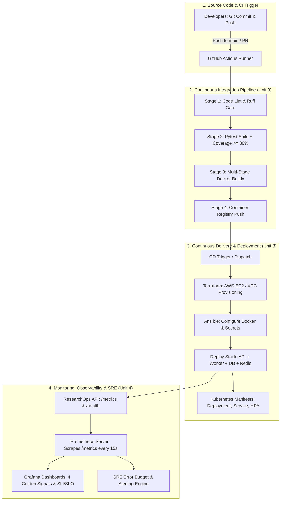

# DevOps FA2 Activity — Comprehensive Implementation Plan
**Course:** PEC 4 - DevOps (7th Semester)  
**Evaluation:** FA2 Activity (10 Marks) — Units 3 & 4  
**Project Title:** ResearchOps AI — Intelligent Literature Intelligence Platform  
**Target Completion Date:** Before 10/10/2026  

---

## 1. Project Selection & Problem Statement

### 1.1 Project Title
**ResearchOps AI**: High-Throughput Literature Intelligence Microservice with End-to-End CI/CD, Infrastructure as Code, and SRE Observability.

### 1.2 Problem Statement & Justification
In academic and industrial research, literature discovery and synthesis across fragmented databases (OpenAlex, Crossref, Wikipedia) is manual, slow, and prone to third-party upstream API outages. Researchers lack unified workspaces that combine discovery, document parsing, and RAG retrieval.
From an operations perspective, running an AI-assisted literature engine requires:
1. Resilient microservice architecture that does not fail when upstream APIs degrade.
2. Strictly automated CI/CD pipelines ensuring continuous testing, zero-downtime container rollout, and reproducible infrastructure.
3. Production-grade observability (Unit 4 SRE) to monitor 4 Golden Signals (latency, traffic, errors, saturation), service-level indicators (SLIs), and service-level objectives (SLOs).

---

## 2. Group Details & Role Matrix (Max 4 Students)

To satisfy **PO1, PO2, PO3, PO4, PO5, PO8, PO12**, the workload is distributed across 4 core engineering roles:

| Member | Role | Primary Responsibilities | Rubric Alignment |
|---|---|---|---|
| **Student 1 (Lead)** | **CI/CD & Source Control Lead** | GitHub Actions workflow design, branch policies, automated linting (`ruff`), automated testing (`pytest-cov`), Docker build & push automation. | PO1, PO2, PO3 (Stages 1-3) |
| **Student 2** | **Infrastructure & Containerization Lead** | Docker multi-stage builds, Docker Compose stack orchestration, Terraform provisioning for AWS EC2 / VPC / Security Groups. | PO1, PO2, PO3, PO5 (Stages 4-5) |
| **Student 3** | **Continuous Deployment & Orchestration Lead** | Ansible configuration management, Kubernetes manifests (Deployments, Services, Ingress, HPA), automated rollout & health validation. | PO2, PO4, PO5 (Stage 5-6) |
| **Student 4** | **Observability & SRE Lead** | Prometheus metrics scraping, Grafana dashboards, SLI/SLO definition, Error Budget tracking, liveness/readiness probes, faculty demo script. | PO1, PO3, PO8, PO12 (Stage 7 & Viva) |

---

## 3. Rubric Compliance & Scoring Strategy (Target: 10/10)

| Rubric Indicator | Max Marks | Target Level | Plan Fulfillment Strategy |
|---|:---:|:---:|---|
| **1. Selection of Methods, Tools and Design** *(PO1, PO2, PO3, PO12)* | **3** | **Excellent (3)** | Complete 7-stage pipeline designed and documented: Source (Git/GitHub) → Build & Lint (Ruff) → Test (Pytest) → Containerize (Docker) → Provision (Terraform) → Deploy (Ansible / K8s) → Monitor (Prometheus / Grafana). |
| **2. Implementation** *(PO1, PO2, PO3, PO4, PO5, PO12)* | **5** | **Excellent (5)** | Fully functional, automated end-to-end pipeline with passing GitHub Actions workflow, live containerized stack, functional Prometheus `/metrics` scraping, and real-time Grafana telemetry dashboards. |
| **3. Timely Submission & Demonstration** *(PO8, PO12)* | **2** | **Excellent (2)** | Complete repository with clean modular architecture, live deployment demo script, SRE dashboard walkthrough, and comprehensive project documentation delivered before deadline. |
| **Total** | **10** | **10 / 10** | |

---

## 4. End-to-End DevOps Architecture

---

## 5. Detailed Stage-by-Stage Implementation Breakdown

### Stage 1: Source Code Management & Versioning
- **Tooling:** Git, GitHub (`Niruuu2005/ResearchHUB`).
- **Branching Model:** Trunk-based development with short-lived feature branches (`feat/*`, `fix/*`).
- **Quality Gates:** Protected `main` branch requiring passing CI tests before merge.

### Stage 2: Continuous Integration & Automated Testing (Unit 3)
- **Tooling:** GitHub Actions (`.github/workflows/ci.yml`), `pytest`, `pytest-cov`, `ruff`.
- **Pipeline Steps:**
  1. Checkout code (`actions/checkout@v4`).
  2. Setup Python 3.12 runtime (`actions/setup-python@v5`).
  3. Install dependencies and caching.
  4. Static code analysis and linting (`ruff check app tests`).
  5. Automated unit & integration tests (`pytest -v --cov=app --cov-report=term-missing`).
  6. Enforce minimum pass rate (all 33+ core tests green).

### Stage 3: Containerization & Artifact Management (Unit 3)
- **Tooling:** Docker, Docker Buildx, Multi-stage builds.
- **Components:**
  - `Dockerfile`: Production image for FastAPI API (`python:3.12-slim`, non-root user).
  - `Dockerfile.worker`: Celery worker image for background document processing.
  - Multi-service orchestration via `docker-compose.yml` (API, Celery, Postgres 16 pgvector, Redis 7, Nginx gateway, Prometheus, Grafana).

### Stage 4: Infrastructure as Code (IaC) & Configuration Management
- **Tooling:** Terraform (v1.5+), Ansible (v2.15+).
- **Terraform Scope:**
  - Automated provisioning of AWS EC2 (`t3.micro`/`t3.small`), Security Groups (allowing 80, 443, 8000, 9090, 3001), and SSH key pair associations.
  - State management and output automation (`public_ip`, `ssh_connection_string`).
- **Ansible Scope:**
  - Automated package installation (`docker`, `docker-compose-plugin`).
  - Repository synchronization, `.env` templating, directory creation, and non-interactive `docker compose up -d` deployment.

### Stage 5: Kubernetes Manifests & Orchestration (Unit 3)
- **Tooling:** Kubernetes / Minikube / K3s / EKS manifests.
- **Manifests in `k8s/`**:
  - `01-namespace.yaml`: Isolated namespace `researchops`.
  - `02-configmap.yaml` & `03-secrets.yaml`: Decoupled configurations.
  - `04-postgres.yaml` & `redis.yaml`: Persistent backends with PVCs.
  - `05-api-deployment.yaml`: Replicas, rolling update strategy, liveness & readiness probes.
  - `06-api-service.yaml`: ClusterIP and NodePort exposure.
  - `07-worker-deployment.yaml`: Celery worker scaling.
  - `08-ingress.yaml`: Ingress routing for Web UI and API.
  - `09-hpa.yaml`: Horizontal Pod Autoscaler based on CPU/Memory utilization.

### Stage 6: Continuous Deployment (CD) Automation (Unit 3)
- **Workflow:** Extended GitHub Actions CD pipeline.
  - On push to `main` and successful CI:
  - SSH deployment to EC2 using Ansible, or automated `kubectl apply -k k8s/`.
  - Post-deployment automated healthcheck probe against `http://<HOST>/health` and `http://<HOST>/ready`.

### Stage 7: Monitoring, Observability & SRE (Unit 4)
- **Tooling:** Prometheus (v2.51.0), Grafana (v10.4.0), Custom Exporters.
- **SRE Core Implementation:**
  - **Liveness Probe:** `/health` (process responsiveness).
  - **Readiness Probe:** `/ready` (verifies DB connection, Redis state, background queue).
  - **Metrics Endpoint:** `/metrics` providing Prometheus standard exposition format.
  - **4 Golden Signals Implementation:**
    1. **Latency:** `researchops_provider_latency_ms` (measuring OpenAlex, Wikipedia, Crossref probe response times).
    2. **Traffic:** Total requests and research runs (`researchops_total_projects`, `researchops_total_papers`).
    3. **Errors:** Provider probe status (`healthy`, `degraded`, `unavailable`) and HTTP error rates.
    4. **Saturation:** `researchops_active_background_jobs`, DB pool utilization, memory/CPU.
  - **Service Level Objectives (SLOs) & Error Budgets:**
    - **Availability SLO:** 99.5% uptime on `/research` endpoint per month (Error budget = 0.5% ~ 3.6 hours).
    - **Latency SLO:** 95% of requests completed under 1500ms.
  - **Grafana Provisioning:**
    - Auto-provisioned datasource (`Prometheus` at `http://prometheus:9090`).
    - Dedicated Dashboard: System health overview, provider latencies, database record metrics, job queue depths.

---

## 6. Execution & Action Items Checklist (Before 10/10/2026)

| Milestone | Task | Owner | Status |
|---|---|---|:---:|
| **M1: Source & Codebase** | Ensure clean code, dependencies frozen in `requirements.txt`, repo organized. | Student 1 | [x] Ready |
| **M2: CI Pipeline** | Verify `.github/workflows/ci.yml` passes tests and Docker builds cleanly. | Student 1 | [x] Ready |
| **M3: Kubernetes Manifests** | Finalize complete Kubernetes manifests in `k8s/` (`deployment`, `service`, `ingress`, `hpa`). | Student 3 | [x] Ready |
| **M4: Infrastructure & IaC** | Verify Terraform script (`terraform/`) and Ansible playbook (`ansible/deploy.yml`). | Student 2 | [x] Ready |
| **M5: Observability & SRE** | Verify Prometheus scraping `/metrics` and Grafana dashboard visualization. | Student 4 | [x] Ready |
| **M6: Live Demonstration Script** | Prepare step-by-step faculty demonstration and viva defense cheat sheet. | All | [x] Ready |

---

## 7. Faculty Demonstration & Viva Script (For 10/10 Marks)

When presenting to the faculty, follow this structured 5-step demonstration:

1. **Architecture & Tool Selection Walkthrough (Rubric 1 — 3 Marks):**
   - Present the end-to-end architecture diagram.
   - Explain why modern tools were chosen: GitHub Actions for CI/CD, Docker & Compose for containerization, Terraform & Ansible for reproducible cloud rollout, Prometheus & Grafana for SRE observability.
2. **CI/CD Pipeline Demonstration (Rubric 2 — 5 Marks):**
   - Trigger a commit or show a recent green GitHub Actions run.
   - Show the 2 stages: Automated Lint/Pytest Suite (33 passed) and Docker Buildx multi-image containerization.
3. **Application & Container Stack Running Live:**
   - Show `docker compose ps` with all 6 microservices running (`api`, `worker`, `postgres`, `redis`, `prometheus`, `grafana`).
   - Demonstrate the web app interface (`http://localhost:8000`), run a live research query (e.g. *"Quantum Computing"*).
4. **Site Reliability Engineering & Observability (Unit 4 Demonstration):**
   - Open `http://localhost:8000/metrics` to show Prometheus raw text metrics.
   - Open Prometheus (`http://localhost:9090`) and query `researchops_provider_latency_ms`.
   - Open Grafana (`http://localhost:3001`) to show live visual telemetry (latency gauges, health checks, active background queues).
   - Show `/ready` and `/health` probe endpoints and explain how they prevent traffic routing to degraded pods.
5. **Documentation & Timely Handover (Rubric 3 — 2 Marks):**
   - Present the well-structured project repository, complete documentation (`docs/`), execution logs, and clear module decomposition.
