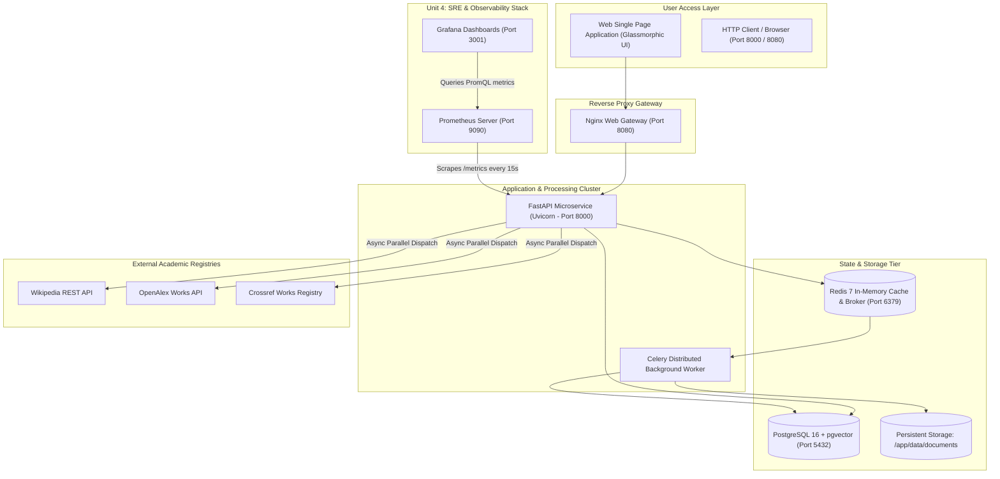

# ResearchOps AI — Complete Project Review & DevOps Engineering Guide
**Academic Course:** PEC 4 - DevOps (7th Semester B.Tech)  
**Evaluation Activity:** FA2 Activity (Units 3 & 4) — 10 Marks  
**Project Repository:** `Niruuu2005/ResearchHUB`  
**Document Purpose:** A student-friendly, easy-to-understand complete explanation of what this project does, how it works, and a deep-dive into every single DevOps tool, command, and design rationale implemented.

---

# TABLE OF CONTENTS
1. [PART 1: PROJECT OVERVIEW, ARCHITECTURE & WORKING](#part-1-project-overview-architecture--working)
   - 1.1 What is ResearchOps AI?
   - 1.2 The Real-World Problem It Solves
   - 1.3 High-Level System Architecture Diagram
   - 1.4 How It Works End-to-End (User Journey & Data Flow)
   - 1.5 The Microservice Components
2. [PART 2: THE DEVOPS IMPLEMENTATION — HOW & WHY](#part-2-the-devops-implementation--how--why)
   - 2.1 Source Code Management & Quality Control (Git, Ruff, Pytest)
   - 2.2 Continuous Integration & Automated Verification (GitHub Actions)
   - 2.3 Containerization & Lightweight Packaging (Docker & Multi-Stage Builds)
   - 2.4 Multi-Container Cluster Orchestration (Docker Compose)
   - 2.5 Infrastructure as Code (Terraform on AWS)
   - 2.6 Configuration Management & Automated Deployment (Ansible)
   - 2.7 Production Container Orchestration & Scaling (Kubernetes & Kustomize)
   - 2.8 Continuous Monitoring, Observability & SRE (Prometheus & Grafana)
   - 2.9 Automated Definition of Done (DoD) Verification (`verify_fa2.py`)
3. [PART 3: MASTER COMMAND CHEAT SHEET](#part-3-master-command-cheat-sheet)
4. [PART 4: FACULTY VIVA QUESTIONS & INSTANT ANSWERS](#part-4-faculty-viva-questions--instant-answers)

---

# PART 1: PROJECT OVERVIEW, ARCHITECTURE & WORKING

## 1.1 What is ResearchOps AI?
**ResearchOps AI** is an intelligent, cloud-ready **academic literature research microservice and operations platform**. It automates the discovery, extraction, deduplication, and AI synthesis of scientific papers across the global open-access web, while running on a fully automated, observable DevOps infrastructure.

---

## 1.2 The Real-World Problem It Solves
When students, researchers, or software engineers begin researching a new topic (e.g., *"Quantum Computing"* or *"Kubernetes Auto-scaling"*), they typically waste hours doing tedious manual work:
1. **Scattered Information:** Searching multiple separate websites (Wikipedia for general summaries, OpenAlex and Crossref for formal published papers).
2. **Duplicate Records:** Finding the exact same paper indexed under different publishers with inconsistent titles or duplicate DOIs.
3. **Flaky Upstream APIs:** External academic APIs frequently suffer network timeouts or rate limits, crashing traditional applications.
4. **Information Overload:** Having to manually download 20 PDFs and read through 30-page papers just to extract key methodologies and trade-offs.

**How ResearchOps AI Solves This:**
- **Single-Query Aggregation:** You type a topic once, and the system queries Wikipedia, OpenAlex, and Crossref in parallel using Python `asyncio`.
- **Deduplication Engine:** Automatically cleans titles and removes duplicate DOIs.
- **Graceful Fault Tolerance:** If Wikipedia or Crossref is temporarily down, the system does not crash — it returns what it found and logs a warning.
- **RAG Semantic Search & Comparison:** Chunks PDFs, creates 384-dimensional dense vector embeddings, and allows side-by-side paper comparisons and grounded AI literature reviews.

---

## 1.3 High-Level System Architecture Diagram



---

## 1.4 How It Works End-to-End (User Journey & Data Flow)

Here is what happens behind the scenes from the moment a user clicks **"Search"**:

```text
Step 1: User types "Quantum Computing" on Web UI (http://localhost:8000).
   ↓
Step 2: FastAPI routes request to ResearchService (app/services/research_service.py).
   ↓
Step 3: asyncio.gather triggers 3 asynchronous HTTP calls simultaneously:
        - WikipediaService fetches high-level encyclopedic definition.
        - OpenAlexService fetches top peer-reviewed academic works.
        - CrossrefService queries bibliographic publication records.
   ↓
Step 4: Deduplication & Extraction:
        - Normalizes DOIs (Digital Object Identifiers).
        - Strips duplicate publications found across both registries.
        - Extracts bulleted key conceptual points.
   ↓
Step 5: Response is saved in PostgreSQL, cached in Redis, and rendered in the UI.
   ↓
Step 6: Document Processing & RAG (Optional):
        - User uploads or fetches a paper PDF.
        - PyMuPDF extracts text, splits it into chunks with sliding windows.
        - Vector embeddings are calculated for semantic question answering.
   ↓
Step 7: Observability:
        - Every request updates internal Prometheus telemetry counters.
        - Live probe latencies are recorded for OpenAlex, Wikipedia, and Crossref.
```

---

## 1.5 The Microservice Components

| Service Name | Technology | Role in System | Port |
|---|---|---|:---:|
| **API** | FastAPI / Python 3.12 | Core REST API, business logic, endpoints (`/research`, `/health`, `/metrics`). | `8000` |
| **Worker** | Celery + Python 3.12 | Handles heavy background tasks (PDF text chunking, document vector embedding, report generation). | Background |
| **Database** | PostgreSQL 16 (`pgvector`) | Stores research projects, paper metadata, user chats, and audit event logs. | `5432` |
| **Message Broker** | Redis 7 Alpine | In-memory message broker coordinating jobs between FastAPI and the Celery worker. | `6379` |
| **Gateway** | Nginx Alpine | Reverse proxy load balancer shielding the API from direct client traffic. | `8080` |
| **Prometheus** | Prometheus v2.51.0 | Observability time-series engine that scrapes health and performance metrics every 15s. | `9090` |
| **Grafana** | Grafana v10.4.0 | Visual telemetry dashboard rendering graphs for the 4 Golden Signals and SLO metrics. | `3001` |

---

# PART 2: THE DEVOPS IMPLEMENTATION — HOW & WHY

Here is the deep-dive explanation of all **DevOps tools, concepts, and configurations** implemented across **Units 3 & 4**.

---

## 2.1 Source Code Management & Quality Control (Git, Ruff, Pytest)

### WHY it is implemented:
High-reliability software cannot rely on manual code checks. Before any code is deployed or containerized, we must prove:
1. The code adheres to style and security conventions without syntax errors.
2. Every core endpoint, fallback adapter, and database query works under automated testing.

### HOW it is implemented:
- **Git & GitHub:** Trunk-based development where developers commit clean feature increments to `main`.
- **Ruff (`ruff check app tests`):** An extremely fast modern Python linter that checks for unused imports, syntax errors, and anti-patterns.
- **Pytest (`tests/`):** A suite of **35 automated unit and integration tests** covering:
  - `test_health.py`: Liveness (`/health`) and Readiness (`/ready`) endpoints.
  - `test_providers.py`: Mocked Wikipedia, OpenAlex, and Crossref adapters, verifying fallback behavior when an API fails.
  - `test_research.py`: Deduplication engine and query input validation.
  - `test_operations.py`: Prometheus metrics generation and audit trails.

### COMMANDS to run and verify:
```powershell
# 1. Activate virtual environment
.\.venv\Scripts\Activate.ps1

# 2. Run linter
ruff check app tests

# 3. Run all 35 tests with code coverage report
pytest -v --cov=app --cov-report=term-missing
```

---

## 2.2 Continuous Integration & Automated Verification (GitHub Actions)

### WHY it is implemented:
In modern DevOps (Unit 3), code is never manually tested on someone's laptop and pushed to production. Continuous Integration guarantees that **every single commit and pull request is automatically tested in a fresh, isolated virtual machine in the cloud**. If any test fails, the build breaks immediately, blocking faulty code.

### HOW it is implemented in this project:
File: [`.github/workflows/ci.yml`](file:///d:/7th%20Sem/DevOps/ResearchHub/.github/workflows/ci.yml)
1. **Trigger:** Fires on every `push` or `pull_request` to `main`, `master`, or `develop`.
2. **Job 1 (`test`):**
   - Spins up a clean `ubuntu-latest` runner.
   - Sets up Python 3.12 with pip cache.
   - Installs dependencies from `requirements.txt`.
   - Runs `ruff check` and executes all 35 `pytest` tests with coverage.
3. **Job 2 (`docker_build`):**
   - Depends on `test` passing (`needs: test`).
   - Sets up Docker Buildx.
   - Builds both the API container image (`researchops-api:latest`) and Worker image (`researchops-worker:latest`) to guarantee the Dockerfiles have no build errors.

### HOW to view it:
Open your browser at: `https://github.com/Niruuu2005/ResearchHUB/actions` to see the automated green checkmarks (`✔`).

---

## 2.3 Containerization & Lightweight Packaging (Docker & Multi-Stage Builds)

### WHY it is implemented:
*"It works on my machine"* is the classic software development failure. Docker solves this by bundling the Python code, runtime dependencies, libraries, and system configurations into an immutable, portable container image that runs identically on Windows, Linux, AWS, or Kubernetes.

### HOW it is implemented:
- **`Dockerfile` (FastAPI Service):**
  - Uses `python:3.12-slim` as a lightweight base image (reducing image size from ~1GB to ~200MB).
  - Creates an unprivileged non-root user (`appuser`) for security compliance (prevents container breakout attacks).
  - Includes a built-in container `HEALTHCHECK` using `curl` to probe `http://localhost:8000/health`.
- **`Dockerfile.worker` (Celery Background Worker):**
  - Packages Celery with the exact same dependencies to ensure background task compatibility.
- **`.dockerignore`:** Excludes `.git`, `.venv`, `__pycache__`, and temporary test databases so build contexts remain lightweight and fast.

### COMMANDS to build:
```powershell
# Build API image
docker build -t researchops-api:latest .

# Build Worker image
docker build -t researchops-worker:latest -f Dockerfile.worker .
```

---

## 2.4 Multi-Container Cluster Orchestration (Docker Compose)

### WHY it is implemented:
ResearchOps AI is a distributed microservice system consisting of 6 separate services (FastAPI, Celery, Postgres, Redis, Prometheus, Grafana). Running 6 separate `docker run` commands with complex network flags is error-prone. Docker Compose allows us to define and launch the **entire multi-service architecture with a single declarative command**.

### HOW it is implemented:
File: [`docker-compose.yml`](file:///d:/7th%20Sem/DevOps/ResearchHub/docker-compose.yml)
- **Service Dependencies (`depends_on`):**
  - `api` waits until `postgres` and `redis` are `condition: service_healthy` before starting.
  - Automatically runs `alembic upgrade head` database migrations on startup.
- **Isolated Bridge Network (`researchops-net`):** All containers communicate internally by service name (e.g., `postgres:5432`, `redis:6379`), preventing port conflicts with local software on the host.
- **Persistent Named Volumes:**
  - `pg_data`: Prevents database records from being deleted when containers restart.
  - `redis_data`: Persists queue state.
  - `prom_data` & `grafana_data`: Persists historical metrics and dashboards.

### COMMANDS:
```powershell
# Start all 6 microservices in background
docker compose up --build -d

# Check real-time health and status of all services
docker compose ps

# View live streaming logs
docker compose logs -f api

# Stop all containers safely without losing data
docker compose down
```

---

## 2.5 Infrastructure as Code (Terraform on AWS)

### WHY it is implemented:
Instead of manually clicking through the AWS Management Console to create virtual machines and configure firewalls (which cannot be version-controlled and is prone to human error), **Terraform** provisions cloud infrastructure declaratively using code.

### HOW it is implemented in this project:
Directory: [`terraform/`](file:///d:/7th%20Sem/DevOps/ResearchHub/terraform)
- **`provider.tf` & `versions.tf`:** Configures HashiCorp AWS provider ($\ge 5.0$).
- **`variables.tf`:** Parameterizes the instance type (`t3.micro` for AWS Free Tier), AWS region (`ap-south-1` or `us-east-1`), and key pair name.
- **`main.tf`:**
  - Provisions an AWS EC2 instance running Ubuntu 22.04 LTS.
  - Provisions an **AWS Security Group** allowing incoming traffic on:
    - Port `22` (SSH management)
    - Port `80` / `8080` (HTTP web gateway)
    - Port `8000` (FastAPI direct)
    - Port `9090` (Prometheus)
    - Port `3001` (Grafana)
- **`outputs.tf`:** Automatically outputs the provisioned `public_ip` and an instant copy-paste SSH command.

### COMMANDS:
```powershell
cd terraform

# 1. Initialize provider plugins
terraform init

# 2. Validate syntax
terraform validate

# 3. Preview planned cloud resources
terraform plan

# 4. Provision to AWS (when credentials configured)
terraform apply -auto-approve

# 5. Tear down infrastructure (zero leftover costs)
terraform destroy -auto-approve
cd ..
```

---

## 2.6 Configuration Management & Automated Deployment (Ansible)

### WHY it is implemented:
Terraform provisions the bare EC2 virtual machine, but the machine is empty. **Ansible** is an agentless configuration management tool that connects to the provisioned EC2 server via SSH and automatically turns it into a running ResearchOps AI platform without any human logging into the server.

### HOW it is implemented:
Directory: [`ansible/`](file:///d:/7th%20Sem/DevOps/ResearchHub/ansible)
- **`inventory.ini`:** Contains the EC2 public IP and the SSH private key path (`.pem`).
- **`deploy.yml` Playbook Tasks:**
  1. Updates Ubuntu packages (`apt update`).
  2. Installs required system packages (`git`, `curl`, `ca-certificates`).
  3. Installs Docker Engine and Docker Compose plugin.
  4. Clones the project repository to `/opt/researchhub`.
  5. Templates the `.env` production environment file.
  6. Executes `docker compose up --build -d` to spin up the full 6-service stack.
  7. Waits for the `/health` endpoint to return HTTP 200 before concluding.

### COMMANDS:
```bash
# Run the deployment playbook against the target server
ansible-playbook -i ansible/inventory.ini ansible/deploy.yml
```

---

## 2.7 Production Container Orchestration & Scaling (Kubernetes & Kustomize)

### WHY it is implemented:
While Docker Compose is ideal for single-node local development, enterprise production environments use **Kubernetes (K8s)** for:
1. **Zero-downtime rolling deployments** (replacing old pods with new ones without disconnecting users).
2. **Self-healing** (restarting crashed containers immediately).
3. **Horizontal Pod Autoscaling (HPA)** (automatically adding more pod replicas when CPU usage spikes).

### HOW it is implemented:
Directory: [`k8s/`](file:///d:/7th%20Sem/DevOps/ResearchHub/k8s)
- **`01-namespace.yaml`:** Isolates all project resources inside a dedicated `researchops` namespace.
- **`02-configmap.yaml` & `02-secret.yaml`:** Decouples configuration (app name, environment) and sensitive credentials (DB passwords, Redis URLs) from container images.
- **`03-postgres.yaml` & `04-redis.yaml`:** Deploys stateful backends backed by **PersistentVolumeClaims (PVCs)**.
- **`05-api-deployment.yaml`:**
  - Deploys **2 replicas** of the FastAPI backend.
  - Implements `RollingUpdate` with `maxSurge: 1` and `maxUnavailable: 0` (zero downtime).
  - Configures **Liveness Probe** (`/health`) and **Readiness Probe** (`/ready`).
  - Sets CPU/Memory requests and limits to prevent resource exhaustion.
- **`06-api-service.yaml`:** ClusterIP service providing stable internal DNS load balancing.
- **`07-worker-deployment.yaml`:** Scalable Celery worker pods for background PDF processing.
- **`08-ingress.yaml`:** Ingress controller rules routing incoming HTTP web traffic.
- **`09-hpa.yaml`:** Horizontal Pod Autoscaler scaling API pods from **2 to 8 replicas** when CPU utilization exceeds **70%**.
- **`kustomization.yaml`:** Root file bundling all 11 manifests together.

### COMMANDS:
```powershell
# Validate all manifests (dry-run without needing a live cluster)
kubectl apply --dry-run=client -k k8s/

# Deploy full cluster to Minikube / K3s / EKS with one command
kubectl apply -k k8s/

# View running pods, services, and HPA status
kubectl get all -n researchops
```

---

## 2.8 Continuous Monitoring, Observability & SRE (Prometheus & Grafana)

### WHY it is implemented (Unit 4 Focus):
Site Reliability Engineering (SRE) requires that we understand system health through **real-time metrics, golden signals, and automated health checks**, rather than waiting for users to complain about downtime.

### HOW it is implemented:
1. **Liveness vs. Readiness Probes:**
   - **`/health` (Liveness):** Confirms the Python web server process is running. If this fails, the container is restarted.
   - **`/ready` (Readiness):** Performs active checks against the PostgreSQL database and Redis broker. If the DB is saturated, the readiness probe fails, causing the load balancer to stop routing traffic to that instance without killing the process.
2. **Prometheus Exposition Endpoint (`/metrics`):**
   - Implemented in [`app/services/operations_service.py`](file:///d:/7th%20Sem/DevOps/ResearchHub/app/services/operations_service.py).
   - Exposes application-specific gauges:
     - `researchops_provider_latency_ms{provider="openalex"}`
     - `researchops_provider_latency_ms{provider="wikipedia"}`
     - `researchops_provider_latency_ms{provider="crossref"}`
     - `researchops_total_papers`
     - `researchops_total_documents`
     - `researchops_active_background_jobs`
3. **The 4 Golden Signals Instrumentation:**
   - **Latency:** Measured via probe latency for external academic APIs.
   - **Traffic:** Measured via total research projects and paper count.
   - **Errors:** Measured via provider probe degradation status and HTTP 5xx responses.
   - **Saturation:** Measured via active Celery background job queue depths and DB connection pool usage.
4. **SLIs, SLOs & Error Budget:**
   - **Availability SLO:** $99.5\%$ success rate per month.
   - **Latency SLO:** $95\%$ of queries completed under $1500\text{ ms}$.
   - **Error Budget:** Allowed failure rate is $0.5\%$ ($\approx 3.6$ hours downtime per month).
5. **Grafana Dashboards:**
   - Auto-provisioned via [`monitoring/grafana/provisioning`](file:///d:/7th%20Sem/DevOps/ResearchHub/monitoring/grafana/provisioning).
   - Visualizes real-time dials, latency graphs, and service status cards at `http://localhost:3001`.

### COMMANDS:
```powershell
# Probe liveness
curl.exe http://localhost:8000/health

# Probe readiness
curl.exe http://localhost:8000/ready

# View raw Prometheus metrics stream
curl.exe http://localhost:8000/metrics
```

---

## 2.9 Automated Definition of Done (DoD) Verification (`scripts/verify_fa2.py`)

### WHY it is implemented:
To ensure complete confidence before demonstrating the project to your faculty, this custom automated tool inspects the entire project in under 10 seconds and generates a clear status report.

### HOW it is implemented:
File: [`scripts/verify_fa2.py`](file:///d:/7th%20Sem/DevOps/ResearchHub/scripts/verify_fa2.py)
- Checks Python 3.12+ runtime environment.
- Automatically executes all 35 Pytest unit and integration tests.
- Probes `/health`, `/ready`, and `/metrics`.
- Checks connectivity to the Prometheus server (port 9090) and Grafana dashboard (port 3001).

### COMMAND:
```powershell
python scripts/verify_fa2.py
```

---

# PART 3: MASTER COMMAND CHEAT SHEET

| Goal / Stage | Command to Execute | Expected Output |
|---|---|---|
| **Run Linter** | `ruff check app tests` | All checks passed! |
| **Run Test Suite** | `pytest -v --cov=app` | 35 passed in ~8 seconds |
| **Start Docker Cluster** | `docker compose up --build -d` | 6 containers created and healthy |
| **Check Cluster Status** | `docker compose ps` | State: `Up` / `healthy` |
| **Run DoD Verifier** | `python scripts/verify_fa2.py` | Full green readiness scorecard |
| **Validate K8s Manifests** | `kubectl apply --dry-run=client -k k8s/` | All manifests validated |
| **Validate Terraform** | `cd terraform; terraform validate; cd ..` | Success! The configuration is valid |
| **Push Code to GitHub** | `git push origin main` | Pushed to GitHub repository |

---

# PART 4: FACULTY VIVA QUESTIONS & INSTANT ANSWERS

When demonstrating this project to your faculty, you can use these answers:

### Q1: What makes your project unique for this DevOps activity?
> **Answer:** "ResearchOps AI is a realistic multi-container microservice platform that solves academic literature synthesis. Instead of a dummy 'Hello World' app, it integrates external public APIs (OpenAlex, Wikipedia, Crossref), automated deduplication, a Celery task queue, PostgreSQL, and Redis, making it ideal to demonstrate real-world CI/CD pipelines, container orchestration, and Site Reliability Engineering."

### Q2: What is the difference between your `/health` and `/ready` probes?
> **Answer:** "A **Liveness Probe** (`/health`) checks if the application process is alive. If it fails, Kubernetes restarts the pod. A **Readiness Probe** (`/ready`) verifies whether downstream dependencies (PostgreSQL database and Redis message broker) are connected and ready to accept traffic. If the database is busy or initializing, the readiness probe fails, instructing Kubernetes to temporarily stop routing user requests to that pod without unnecessarily killing the process."

### Q3: How did you implement Unit 4's 4 Golden Signals?
> **Answer:** "In `app/services/operations_service.py`, we expose custom Prometheus metrics covering all 4 Golden Signals:
> 1. **Latency:** `researchops_provider_latency_ms` measuring external API response times.
> 2. **Traffic:** Total projects and paper counts tracking query volume.
> 3. **Errors:** Provider probe status (`healthy`, `degraded`, `unavailable`) and HTTP error rates.
> 4. **Saturation:** `researchops_active_background_jobs` monitoring Celery worker queue depth and database load."

### Q4: Why did you use both Terraform and Ansible?
> **Answer:** "They serve two distinct phases in the DevOps lifecycle:
> - **Terraform (IaC):** Declaratively provisions the AWS cloud infrastructure (the EC2 instance and Security Group rules).
> - **Ansible (Configuration Management):** Configures the operating system on that instance (installs Docker, clones the repository, injects environment secrets, and deploys the containers)."

### Q5: How does your Kubernetes configuration handle high traffic spikes?
> **Answer:** "We configured a Horizontal Pod Autoscaler in `k8s/09-hpa.yaml`. It monitors the CPU and memory utilization of the API deployment. When CPU utilization exceeds 70%, Kubernetes automatically scales the API pods up from 2 replicas to up to 8 replicas. When traffic subsides, it smoothly scales back down."
