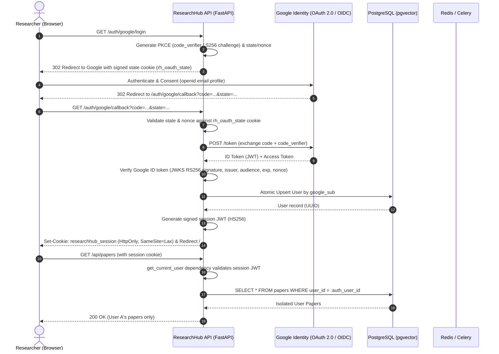

# Google Authentication & Multi-User PostgreSQL Data Isolation Guide

## 1. Executive Summary & Architecture Overview

ResearchHub has been upgraded from a single-tenant workspace into an enterprise-grade multi-user research platform. User authentication is powered by **Google OpenID Connect (OIDC) / OAuth 2.0 authorization-code flow with PKCE**, backed by the existing **PostgreSQL (pgvector)** database with complete user data isolation.

### Core Security Guarantees:
- **Strict Data Isolation**: User A can **never** view, search, modify, delete, download, or access User B's research papers, document PDFs, notes, summaries, pgvector embeddings, chat sessions, background jobs, or exported reports.
- **Session-Derived Identity**: User identity is derived strictly from validated server-managed cryptographic session tokens (`researchhub_session` HttpOnly cookie or `Authorization: Bearer` header). Client-supplied query parameters, headers, or request bodies are never trusted for identity or ownership.
- **Stable Identity Key**: The Google OpenID Connect `sub` claim (`google_sub`) is strictly enforced as the immutable user identity key in PostgreSQL, preventing account takeover or orphan records if an email address changes.
- **Path Traversal Protection**: Uploaded PDFs and generated export reports are isolated in server-controlled directory trees (`storage_path / user_id / ...`) and strictly validated against path traversal attacks.



---

## 2. PostgreSQL Multi-User Schema & Alembic Migration

### Users Table Schema
The migration `b2c3d4e5f6a7_add_users_and_multi_user_isolation.py` creates the canonical `users` table:

```sql
CREATE TABLE users (
    id VARCHAR(36) PRIMARY KEY, -- Native UUID on PostgreSQL, CHAR(36) on SQLite
    google_sub VARCHAR(255) UNIQUE NOT NULL,
    email VARCHAR(320) NOT NULL,
    full_name VARCHAR(255),
    profile_picture TEXT,
    created_at TIMESTAMP WITH TIME ZONE DEFAULT NOW() NOT NULL,
    updated_at TIMESTAMP WITH TIME ZONE DEFAULT NOW() NOT NULL,
    last_login_at TIMESTAMP WITH TIME ZONE
);

CREATE INDEX ix_users_google_sub ON users (google_sub);
CREATE INDEX ix_users_email ON users (email);
```

### User Ownership on Data Tables
The following tables are updated with nullable, indexed `user_id` foreign keys with `ON DELETE CASCADE`:
1. `papers` (`user_id` -> `users.id`)
2. `research_projects` (`user_id` -> `users.id`)
3. `paper_documents` (`user_id` -> `users.id`)
4. `chat_sessions` (`user_id` -> `users.id`)
5. `research_notes` (`user_id` -> `users.id`)
6. `export_reports` (`user_id` -> `users.id`)
7. `research_sessions` (`user_id` -> `users.id`)
8. `background_jobs` (`user_id` -> `users.id`)

### Legacy Data Migration & Quarantine Strategy
- Existing legacy rows in development/staging databases remain intact because `user_id` columns are created **nullable**.
- **Quarantine Rule**: Unowned records (`user_id IS NULL`) are restricted and hidden from normal authenticated user queries.
- **Admin Reconciliation**: An administrative backfill script may map legacy papers to a designated initial administrator account if verified, but unowned records are never automatically reassigned to arbitrary sign-ins.

---

## 3. Google Cloud Console Setup (Step-by-Step)

### Step 1: Create or Select Google Cloud Project
1. Navigate to the [Google Cloud Console](https://console.cloud.google.com/).
2. Click the project dropdown in the top bar and click **New Project**.
3. Name your project (e.g., `ResearchHub-Academic`) and click **Create**.

### Step 2: Configure OAuth Consent Screen
1. In the sidebar, navigate to **APIs & Services** > **OAuth consent screen**.
2. Select User Type:
   - **Internal**: If deploying within a Google Workspace organization.
   - **External**: For public access or testing with specific Google accounts.
3. Click **Create** and complete App Information:
   - **App name**: `ResearchHub`
   - **User support email**: Your support or admin email.
   - **Developer contact information**: Your technical contact email.
4. **Scopes**: Click **Add or Remove Scopes** and select only minimal non-sensitive identity scopes:
   - `.../auth/userinfo.email`
   - `.../auth/userinfo.profile`
   - `openid`
   *(Do NOT request Google Drive, Gmail, or sensitive scopes—ResearchHub only requires OpenID identity verification).*
5. **Test Users** (When App Status is *Testing*):
   - Under **Test users**, click **Add Users**.
   - Add all Google email addresses that will be used to log in during development.

### Step 3: Create OAuth 2.0 Web Client Credentials
1. Navigate to **APIs & Services** > **Credentials**.
2. Click **Create Credentials** > **OAuth client ID**.
3. Application type: Select **Web application**.
4. Name: `ResearchHub Web Client`.
5. **Authorized JavaScript origins**:
   - `http://localhost:8000`
   - `http://localhost:8085` (if accessing through external gateway)
   - `https://your-production-domain.com` (for production HTTPS)
6. **Authorized redirect URIs**:
   - `http://localhost:8000/auth/google/callback`
   - `https://your-production-domain.com/auth/google/callback`
7. Click **Create**.
8. Copy the generated **Client ID** and **Client Secret**.

---

## 4. Environment Configuration

Configure `.env` using your Google credentials:

```bash
# ---------------------------------------------------------------------------
# Google OAuth 2.0 & Session Configuration
# ---------------------------------------------------------------------------
GOOGLE_CLIENT_ID=your-google-client-id.apps.googleusercontent.com
GOOGLE_CLIENT_SECRET=GOCSPX-your-google-client-secret
GOOGLE_REDIRECT_URI=http://localhost:8000/auth/google/callback
SESSION_SECRET_KEY=generate-at-least-32-random-bytes-for-session-signing
SESSION_COOKIE_NAME=researchhub_session
SESSION_MAX_AGE_SECONDS=604800  # 7 days
APP_BASE_URL=http://localhost:8000
ALLOW_MOCK_AUTH=false           # Set to true only for offline development / CI
```

To generate a secure `SESSION_SECRET_KEY`:
```bash
python -c "import secrets; print(secrets.token_urlsafe(32))"
```

---

## 5. Security & Multi-User Isolation Guarantees

### Backend Authorization Dependency
All protected endpoints inject `get_current_user` from `app.api.dependencies`:
```python
@router.get("/papers/{paper_id}", response_model=Paper)
async def get_paper(
    paper_id: int,
    current_user: User = Depends(get_current_user),
    db: Session = Depends(get_db),
):
    paper = db.query(Paper).filter(
        Paper.id == paper_id,
        Paper.user_id == current_user.id
    ).first()
    if not paper:
        raise HTTPException(status_code=404, detail="Paper not found.")
    return paper
```

### pgvector Semantic Search Isolation
Vector chunk similarity queries strictly filter by `Paper.user_id == current_user.id` **inside the database retrieval query**:
```python
results = (
    db.query(PaperChunk, Paper)
    .join(Paper, Paper.id == PaperChunk.paper_id)
    .filter(Paper.user_id == user_id)
    .order_by(PaperChunk.embedding.cosine_distance(query_vector))
    .limit(limit)
    .all()
)
```

### PDF & Export Storage Isolation
Uploaded PDFs and compiled research exports are stored under user-partitioned directories:
```
data/documents/<user-uuid>/<document-uuid>.pdf
data/exports/<user-uuid>/<report-filename>.pdf
```
Both endpoints enforce strict path containment:
```python
file_path = Path(document.file_path).resolve()
storage_root = Path(settings.storage_path).resolve()
file_path.relative_to(storage_root)  # Raises ValueError on path traversal attempts
```

---

## 6. PostgreSQL Row-Level Security (RLS) Evaluation

### Architectural Trade-off Analysis:
- **Connection Pooling Consideration**: In asynchronous FastAPI / SQLAlchemy deployments using connection pooling, application threads share pooled database connections. Applying RLS via `SET LOCAL app.current_user_id = ...` requires meticulous transaction-scoped management; connection reuse without strict resetting risks identity leakage across concurrent HTTP requests.
- **Role Permissions**: If application queries execute as table owner or superuser, PostgreSQL defaults to bypassing RLS (`BYPASSRLS`).
- **Antigravity Defense Strategy**: ResearchHub implements **Defense-in-Depth**:
  1. Primary Barrier: Infallible backend query authorization in `get_current_user` and ORM/SQL query scoping on `Paper.user_id == current_user.id`.
  2. Database Barrier: PostgreSQL foreign-key constraints, cascading deletes, and unique compound indexes.
  3. Optional RLS Policy (for dedicated non-superuser application roles):
     ```sql
     ALTER TABLE papers ENABLE ROW LEVEL SECURITY;
     CREATE POLICY user_paper_isolation ON papers
         USING (user_id = current_setting('app.current_user_id', true)::uuid);
     ```

---

## 7. Automated Testing & Verification

The test suite includes 51 automated tests covering end-to-end functionality, authentication security, and multi-user data isolation.

### Running the Test Suite:
```bash
pytest -v
```

### Verified Test Categories:
1. **Authentication Suite (`tests/test_auth.py`)**:
   - `test_unauthenticated_request_is_rejected`: HTTP 401 on unauthenticated access.
   - `test_invalid_session_token_is_rejected`: HTTP 401 on tampered tokens.
   - `test_expired_session_token_is_rejected`: HTTP 401 on expired tokens.
   - `test_google_login_starts_oidc_flow`: RFC 7636 PKCE S256 parameters and signed state cookies.
   - `test_callback_rejects_missing_state`: CSRF protection against login replay attacks.
   - `test_mock_login_creates_new_user`: Atomic user creation in PostgreSQL.
   - `test_repeated_login_reuses_existing_account`: Stable account reuse by `google_sub`.
   - `test_auth_me_returns_profile`: Safe profile disclosure without leaking sensitive secrets.
   - `test_logout_clears_cookie`: Session invalidation and cookie clearing.

2. **User Isolation Suite (`tests/test_user_isolation.py`)**:
   - `test_papers_isolation_between_users`: User A's papers are completely invisible (HTTP 404) to User B.
   - `test_pdf_document_isolation`: User B cannot download or upload PDFs to User A's papers.
   - `test_summaries_and_comparisons_isolation`: Summaries and cross-paper comparisons are strictly isolated.
   - `test_projects_and_notes_isolation`: Research projects and notes cannot be read, updated, or deleted cross-user.
   - `test_export_reports_isolation`: Compiled PDF/Markdown reports are isolated and protected.
   - `test_background_job_isolation`: Celery tasks and background job statuses are private to the owning user.
   - `test_chat_paper_isolation`: RAG chat sessions reject queries from unauthorized users.
